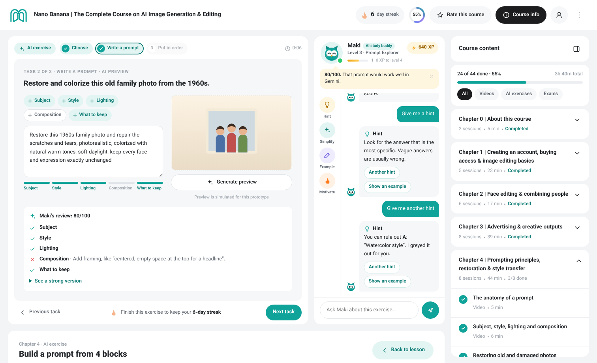
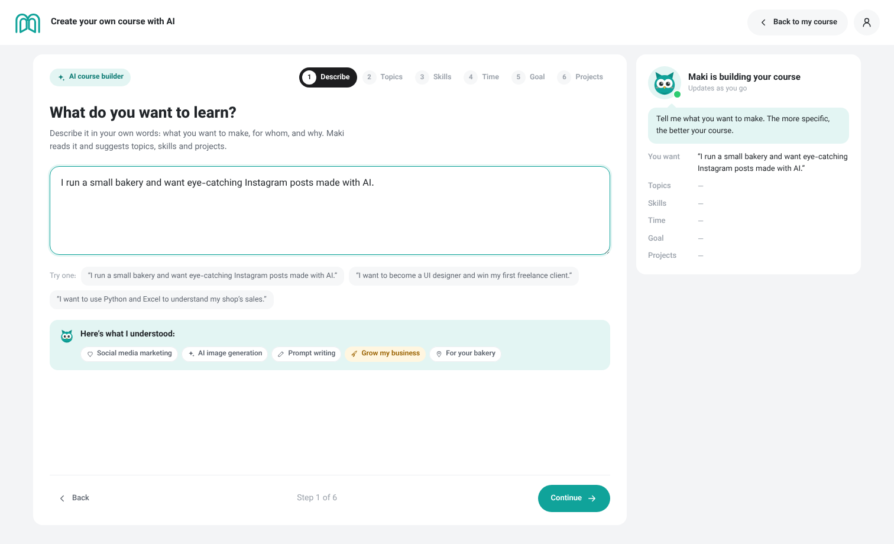
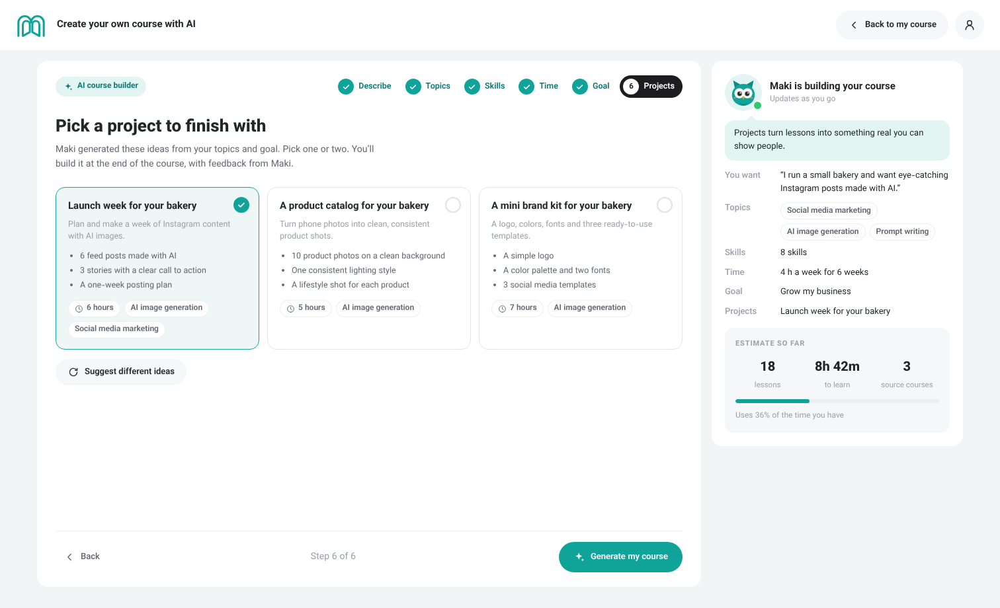
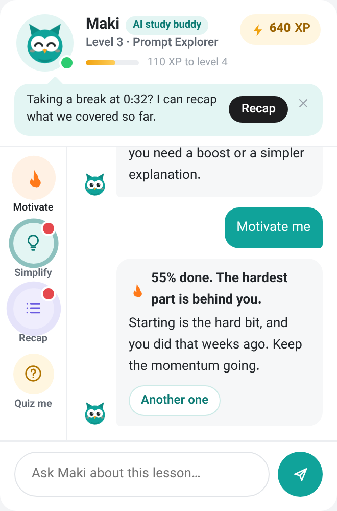

# Maktabkhooneh course page redesign

An English, LTR prototype of the Maktabkhooneh learning experience. It keeps the original look (teal brand, grey page background, white rounded cards, pill buttons, Vazirmatn type) and adds learning-motivation features.

Open `index.html` in a browser. There is no build step. Progress, XP and streaks are saved in the browser, so they carry across pages.

| Page | File |
| --- | --- |
| Course page (lesson player) | `index.html` |
| Exercise page | `exercise.html?ex=ex4` (opened by clicking an AI exercise in the course content) |
| Create a course with AI | `create.html` (also in the **⋮** menu) |

## What's on the page

| Area | What it does |
| --- | --- |
| **Video player** | Play/pause, seek, back 10 s, speed (1×–2×), captions, full screen. A bar under the video shows today's streak goal. |
| **Maki, the AI study buddy** | A small teal owl whose ear tufts echo the logo's arches. Maki answers questions about the lesson in the chat. Its face changes with what's happening: happy, thinking, cheering, or sleepy when you've been idle. |
| **Help circles** | Four round buttons beside the chat: **Motivate** (a personal boost based on your progress, streak and time left), **Simplify** (explains the lesson in plain words, then in one line), **Recap** and **Quiz me**. A circle shows a red dot when Maki thinks it would help, for example Simplify after you replay a part. |
| **Tips** | Reactions to what you do (pausing, replaying, 2× speed, finishing a lesson, leaving the tab, idling, streaks, results) appear as **one** tip bubble under Maki's face. A new tip replaces the old one and it hides after 15 s, so the chat only holds your conversation. |
| **Streak** | The badge in the header opens a weekly view. A day counts when you watch **1 minute of video** or finish **1 AI exercise**. |
| **Course content** (right panel) | Chapters with videos, **AI exercises** (open the exercise page) and **exams** (timed, 70% pass mark). You can filter by type. |
| **On-site course** | Comes after the last chapter. It unlocks once every lesson and exercise is done and the final exam is passed. It shows the graduate price (40% off) and lets you reserve a seat. |
| **Lesson details** | Title, like/dislike, report a problem, lesson summary, "up next", and time-stamped notes. |

Use the **⋮** menu → *Demo: complete everything* to see the unlocked on-site offer, and *Demo: reset progress* to start over.

## Exercise page

The same layout as the course page, with the video replaced by an interactive exercise. Each exercise has a few tasks:

- **Choose:** multiple choice. Press 1–4 to answer from the keyboard.
- **Write a prompt:** a prompt studio. Tap a building block (subject, style, lighting, composition, what to keep) to add it, and a meter fills as you write. *Generate preview* draws a simulated AI image that reacts to your words: night, golden hour, retro poster, watercolor, close-up, space for a headline, restored or colorized.
- **Put in order:** drag the steps, or use the arrow buttons.
- **Deliver:** a project checklist plus a short reflection. Used for projects in AI-made courses.

Maki's circles here are **Hint**, **Simplify**, **Example** and **Motivate**. Hints get more specific each time; on multiple choice they grey out a wrong answer, and they never lower the score. If the learner is idle on a task, answers wrong or almost finishes a prompt, Maki shows a tip. The results screen shows the score per task, XP and the next item. Attempts are listed under *My attempts*.

## Create a course with AI

Six steps, with Maki summarising the course on the right as it takes shape:

1. **Describe** what you want in your own words. Maki picks out topics, a goal and your business (for example "bakery").
2. **Topics:** Maki marks the suggested ones; add or remove any.
3. **Skills:** set your level per topic (beginner lessons are skipped if you're confident) and pick the skills you want.
4. **Time:** hours per week, how many weeks, session length.
5. **Goal:** grow a business, win freelance clients, land a job, create for fun, or earn a certificate.
6. **Projects:** ideas generated from your topics and goal. Pick one or two.

Maki then builds a course from lessons of several Maktabkhooneh courses, fitted to your time. Each lesson shows the course it comes from. Each topic becomes a module with its own AI exercise, and your projects come last. You can swap or remove lessons, see a weekly plan and the price compared with buying the full courses, then **Start learning** to open it in the course player.

| Describe | Projects | Your course |
| --- | --- | --- |
|  |  |  |

The AI parts are simulated: keyword matching and a small mock catalog stand in for a real model.

| Maki | Streak | On-site unlocked |
| --- | --- | --- |
|  |  |  |

Maki's moods: happy, thinking, cheering, sleepy.

## Files

- `index.html`, `exercise.html`, `create.html`: the three pages
- `css/course.css`: shared styles and design tokens; `css/exercise.css` and `css/create.css` for page-specific styles
- `js/core.js`: shared data and logic: course content, saved progress, streak, XP, Maki, the course content panel, the on-site card and dialogs
- `js/course.js`: video player, lesson details and notes
- `js/exercise.js`: the interactive exercise workspace
- `js/create.js`: the AI course builder and its mock course catalog
