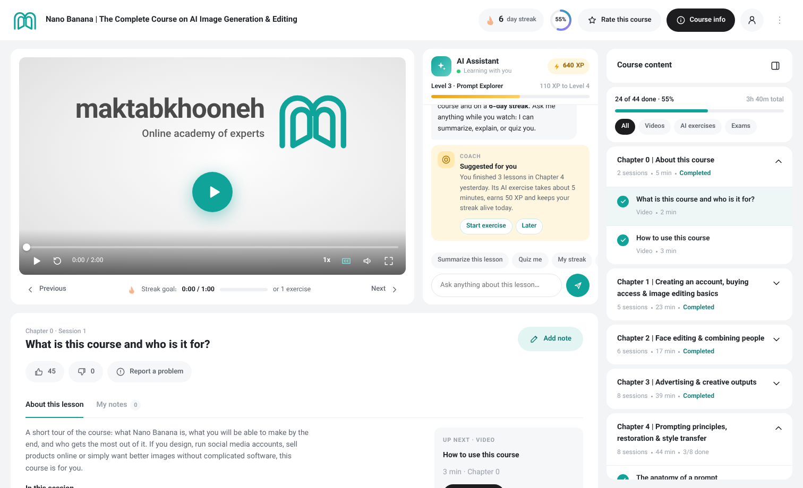
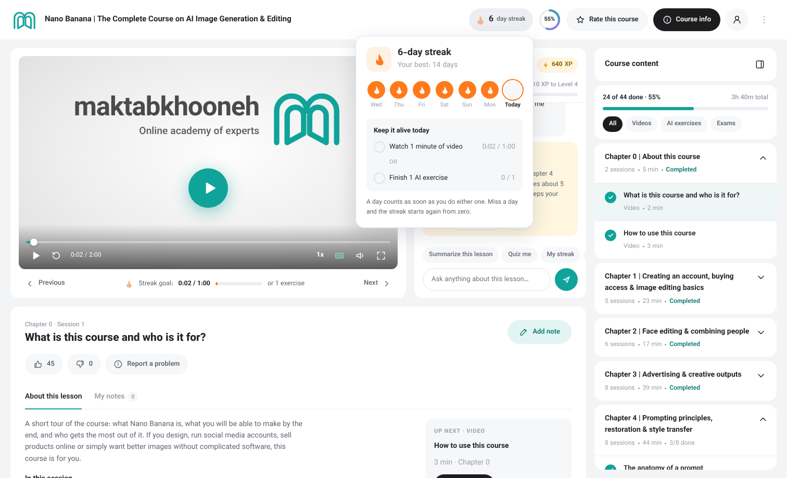
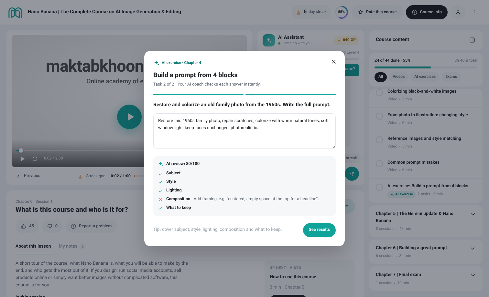
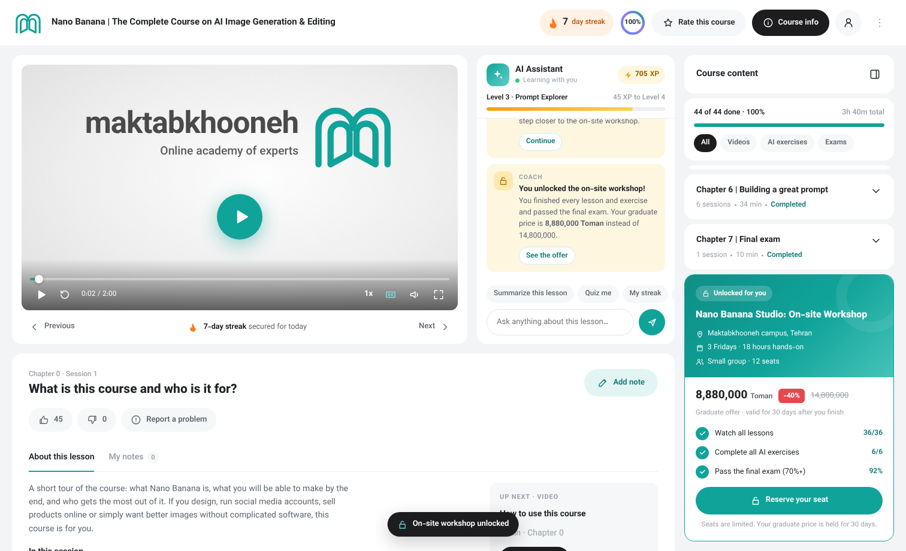

# Maktabkhooneh course page redesign

An English, LTR prototype of the Maktabkhooneh course player. It keeps the original look (teal brand, grey page background, white rounded cards, pill buttons, Vazirmatn type) and adds learning-motivation features.

Open `index.html` in a browser. There is no build step.

## What's on the page

| Area | What it does |
| --- | --- |
| **Video player** | Play/pause, seek, back 10 s, speed (1×–2×), captions, full screen. A bar under the video shows today's streak goal. |
| **AI assistant** | Answers questions about the lesson (summarize, explain simply, quiz me, streak, exams, on-site course). It also sends coach messages based on what you do: pausing, replaying a section, watching at 2×, finishing a lesson, leaving the tab, or not starting yet. It tracks a learning score (XP) and levels. |
| **Streak** | The badge in the header opens a weekly view. A day counts when you watch **1 minute of video** or finish **1 AI exercise**. |
| **Course content** (right panel) | Chapters with videos, **AI exercises** (multiple choice plus prompt-writing tasks with instant AI feedback) and **exams** (timed, 70% pass mark). You can filter by type. |
| **On-site course** | Comes after the last chapter. It unlocks once every lesson and exercise is done and the final exam is passed. It shows the graduate price (40% off) and lets you reserve a seat. |
| **Lesson details** | Title, like/dislike, report a problem, lesson summary, "up next", and time-stamped notes. |

Use the **⋮** menu → *Demo: complete everything* to see the unlocked on-site offer, and *Demo: reset progress* to start over.

| Streak | AI exercise | On-site unlocked |
| --- | --- | --- |
|  |  |  |

## Files

- `index.html`: page markup
- `css/course.css`: styles and design tokens
- `js/course.js`: course data, player, AI assistant, streak, exercises, exams and unlock logic (mock data, all client-side)
