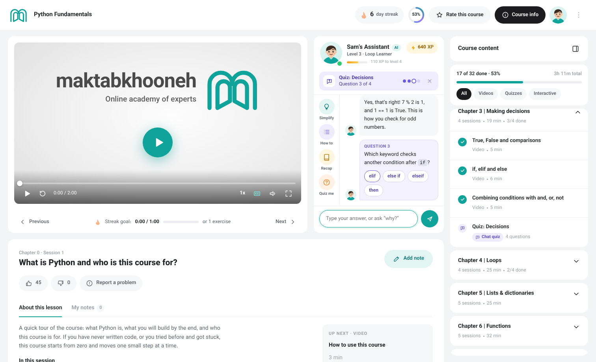
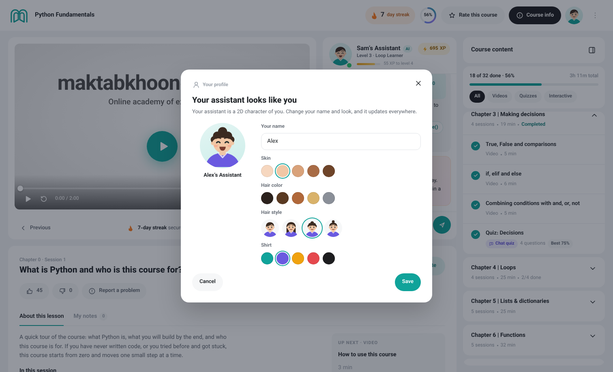
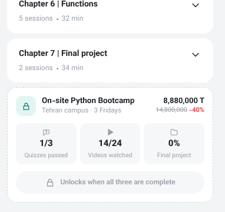

# Maktabkhooneh course page redesign

An English, LTR prototype of the Maktabkhooneh learning experience, shown with the course **Python Fundamentals**. It keeps the original look (teal brand, grey page background, white rounded cards, pill buttons, Vazirmatn type) and adds learning-motivation features.

Open `index.html` in a browser. There is no build step. Progress, XP, streaks and your profile are saved in the browser, so they carry across pages. Coding exercises need an internet connection the first time, to load Python.

| Page | File |
| --- | --- |
| Course page (lesson player) | `index.html` |
| Interactive exercise | `exercise.html?ex=i3` (opened by clicking an interactive item in the course content) |
| Create a course with AI | `create.html` (also in the **⋮** menu) |

## Course page

| Area | What it does |
| --- | --- |
| **Video player** | Play/pause, seek, back 10 s, speed (1×–2×), captions, full screen. A bar under the video shows today's streak goal. |
| **Your assistant** | Named after you (“Sam’s Assistant”) and drawn as a 2D character of you. Its face changes with what's happening: happy, thinking, cheering, sleepy when you're idle. Click the face or your header avatar to change your name, skin, hair and shirt. |
| **Help circles** | Beside the chat: **Simplify**, **How to**, **Recap**, **Quiz me** on the course page; **Hint**, **Simplify**, **How to**, **Example** on exercises. |
| **Motivation** | There is no motivate button. Motivation comes from what you do: returning, pausing, replaying a part, watching fast, finishing a lesson, hitting 25/50/75/90%, idling, streaks, getting stuck on code. It appears in the chat as a **“Just for you”** message with a warm background and suggested next steps (Simplify this, How do I do that?, Show an example…). Only the newest one keeps its suggestions, so the chat stays tidy. |
| **Course content** (right panel) | Chapters with videos and two kinds of practice, filterable: **chat quizzes** (speech-bubble question icon) and **interactive** exercises (code icon). The final project closes the course. |
| **On-site bootcamp** | A compact card after the last chapter: quizzes passed (e.g. 1/3), videos watched (14/24) and final project completion (0%). It unlocks when all three are complete. |
| **Lesson details** | Title, like/dislike, report a problem, lesson summary, "up next", and time-stamped notes. |

### Chat quizzes

Clicking a quiz starts a conversation in the assistant panel. A bar above the chat shows the quiz and your progress. Tap an answer, type it (the text, a letter or a number), or ask "why?" or "give me a hint" before answering. The assistant explains every answer, then shows your score, XP and what's next. You need 60% to pass.

| Chat quiz | Edit your character |
| --- | --- |
|  |  |

## Interactive exercises

The video area becomes a coding panel. You write real Python in an editor with syntax colours, line numbers, auto-indent and Tab. It runs in your browser (Pyodide in a background worker) as you type, and you see the output and **live checks** right away. Programs that ask for `input()` get the player's answers automatically. A loop that never ends is stopped after 3 seconds.

When you press **Run** and there's an error, the assistant explains it in plain words (for example, “Python doesn’t know the name `prnt` yet. Did you mean `print`?”) and highlights the line. Hints get more specific each time and never lower your score. **Example** shows a working solution.

Exercises in this course: a welcome card, a tip calculator, FizzBuzz, a grade function, and the final project, a **number guessing game** built in three steps.

## Create a course with AI

Six steps, with your assistant summarising the course on the right as it takes shape:

1. **Describe** what you want in your own words. The assistant picks out topics, a goal and your business (for example "bakery").
2. **Topics:** suggested ones are marked; add or remove any.
3. **Skills:** set your level per topic (beginner lessons are skipped if you're confident) and pick the skills you want.
4. **Time:** hours per week, how many weeks, session length.
5. **Goal:** grow a business, win freelance clients, land a job, create for fun, or earn a certificate.
6. **Projects:** ideas generated from your topics and goal. Pick one or two.

The assistant then builds a course from lessons of several Maktabkhooneh courses, fitted to your time. Each lesson shows the course it comes from. Each topic becomes a module with a chat quiz and an interactive practice (real Python for Python and data topics). Your projects come last. You can swap or remove lessons, see a weekly plan and the price compared with buying the full courses, then **Start learning** to open it in the course player.

| Describe | Projects | Your course |
| --- | --- | --- |
|  |  |  |

Use the **⋮** menu → *Demo: complete everything* to see the unlocked on-site offer, and *Demo: reset progress* to start over.

The assistant's answers, quiz feedback and course building are simulated with rules and mock data. Only the Python code really runs.

## Files

- `index.html`, `exercise.html`, `create.html`: the three pages
- `css/course.css`: shared styles and design tokens; `css/exercise.css` and `css/create.css` for page-specific styles
- `js/core.js`: shared data and logic: course content, chat quizzes, saved progress, streak, XP, your assistant and character, the course content panel, the on-site card and dialogs
- `js/course.js`: video player, lesson details and notes
- `js/exercise.js`: the interactive workspace: Python runner, editor, checks and error explanations
- `js/create.js`: the AI course builder and its mock course catalog
